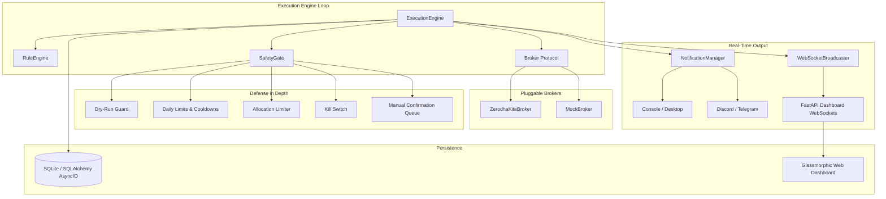

# Portfolio Automation Engine 📈⚙️

An advanced, highly decoupled, asynchronous algorithmic portfolio management and execution system designed for Indian stock brokers (such as Zerodha Kite Connect). Featuring declarative YAML strategy rules, robust multi-layer safety gates, multi-channel alerting, and a real-time glassmorphic web dashboard.

---

## Architecture Overview



---

## Key Features

- **Declarative YAML Strategies**: Define buy queues with priority ranking and sell rules using human-readable conditions (e.g., RSI, Moving Average Crossovers, Allocation Limits, Price Targets).
- **Pluggable Broker Interface**: Switch effortlessly between live trading via **Zerodha Kite Connect** and simulated paper trading via the fully integrated **Mock Broker**.
- **Multi-Layered Safety Gates**:
  - **Dry-Run Guard**: Simulate all order executions safely without real financial exposure.
  - **Kill Switch**: Immediate emergency halt that blocks any further order placement.
  - **Risk Governors**: Configurable daily trade counts, maximum daily investment volume, per-stock allocation percentages, and post-trade cooldown timers.
  - **Manual Confirmation**: Flag sensitive or high-value orders for explicit manual review before placement.
- **Asynchronous Multi-Channel Notifications**: Decoupled, non-blocking alert dispatch across Console, Desktop system notifications, Discord Webhooks, and Telegram Bots with rate-limiting throttling.
- **Real-Time Web Dashboard**: Built with FastAPI, Jinja2, and Tailwind CSS featuring a glassmorphic dark UI, live WebSocket updates, interactive Chart.js analytics, and full strategy/rule management.
- **Production-Ready Containerization**: Optimized multi-stage Docker build (`< 500MB`) running as a secure non-root user with automated health checks.

---

## Quick Start

### Prerequisites
- **Python 3.13+**
- **[uv](https://docs.astral.sh/uv/)** package manager
- **Docker & Docker Compose** (for container deployment)

### 1. Installation
Clone the repository and install dependencies using `uv`:
```bash
git clone https://github.com/yourusername/portfolio-automation-engine.git
cd portfolio-automation-engine

# Install project and dev dependencies
uv sync
```

### 2. Environment Setup
Copy the example environment file and configure your API keys and credentials:
```bash
cp .env.example .env
```

### 3. Running Locally
Start the execution engine and real-time dashboard concurrently in two terminal sessions:

**Terminal 1 (Execution Engine):**
```bash
uv run portfolio-automation
```

**Terminal 2 (FastAPI Dashboard):**
```bash
uv run uvicorn portfolio_automation.dashboard.app:app --host 127.0.0.1 --port 8000 --reload
```
Open your browser to [http://127.0.0.1:8000](http://127.0.0.1:8000).

### 4. Running with Docker Compose (Recommended for Production)
Launch both the engine and dashboard in isolated, auto-restarting Docker containers:
```bash
docker-compose up -d --build
```
Check container logs and health status:
```bash
docker-compose logs -f
docker-compose ps
```

---

## Configuration Guide

### System Configuration (`config/default.yaml`)
```yaml
broker:
  type: mock                   # 'mock' or 'zerodha'

execution:
  poll_interval_seconds: 60    # Loop execution interval
  market_open: "09:15"         # IST trading start time
  market_close: "15:30"        # IST trading close time
  buy_queue_on_failure: skip   # Action on order failure ('skip' or 'retry')

safety:
  dry_run: true                # Enable paper simulation mode
  max_daily_trades: 10         # Maximum executed trades per day
  max_daily_investment: 100000.0 # Maximum total INR spent buying per day
  max_allocation_per_stock: 0.20 # Max 20% total portfolio allocation per stock
  cooldown_minutes: 30         # Cooldown timer after a symbol trade
  manual_confirmation: false   # Require manual approval before executing
  kill_switch_enabled: true    # Enable emergency kill switch toggle

database:
  path: "data/portfolio.db"

notifications:
  enabled: true
  channels:
    console: { enabled: true, level: INFO }
    discord: { enabled: false, webhook_url: "${DISCORD_WEBHOOK_URL}" }
    telegram: { enabled: false, bot_token: "${TELEGRAM_BOT_TOKEN}", chat_id: "${TELEGRAM_CHAT_ID}" }
```

### Strategy Rules Syntax (`config/rules.yaml`)
Strategies are configured in structured YAML defining a prioritized `buy_queue` and parallel `sell_rules`.

#### Supported Rule Condition Types:
- `price_above` / `price_below`: Exact threshold price checks.
- `percent_profit` / `percent_loss`: Return-on-investment percentage triggers relative to average entry cost.
- `rsi`: Relative Strength Index momentum check (`period`, `lower` for oversold, `upper` for overbought).
- `ma_crossover`: Moving average comparison (`fast_period`, `slow_period`, `value: above/below`).
- `macd`: MACD trend direction (`fast_period`, `slow_period`, `signal_period`, `trend: bullish/bearish`).
- `allocation_percentage`: Enforces portfolio weighting bounds.
- `time_based`: Evaluates active trading hours (`start_time`, `end_time`).

---

## Usage Examples

### Example Strategy: RSI Dip Buy & Profit/Stop-Loss Exit
Save the following as `config/rules.yaml`:
```yaml
buy_queue:
  - symbol: RELIANCE
    priority: 1
    condition:
      type: rsi
      params:
        period: 14
        lower: 32
  - symbol: INFY
    priority: 2
    condition:
      type: price_below
      params:
        threshold: 1450.0

sell_rules:
  - symbol: RELIANCE
    condition:
      type: percent_profit
      params:
        percentage: 8.5
  - symbol: RELIANCE
    condition:
      type: percent_loss
      params:
        percentage: 3.0
```

### Dashboard Operations
- **System Kill Switch**: Navigate to the **Settings** tab (`/settings`). Toggle the red **Emergency Kill Switch** button. When activated, all incoming buy and sell signals are immediately blocked across the execution loop.
- **Manual Trade Approval**: If `manual_confirmation: true` is configured, pending orders appear in the **Manual Confirmations** queue on the Settings page. Review symbol details and click **Approve** or **Reject**.
- **Live Strategy Updates**: Modify or paste YAML directly into the **Strategy Rules Editor** on the Settings page and click **Save Rules**. The new strategy takes effect immediately without engine restart.

---

## Development Guide

### Adding a New Broker
1. Implement the `Broker` protocol defined in `src/portfolio_automation/brokers/interface.py`.
2. Ensure your class implements `get_holdings()`, `get_cash_balance()`, `place_order()`, and `get_order_status()`.
3. Register your implementation in `src/portfolio_automation/brokers/factory.py`.

### Adding a New Rule Condition
1. Create a custom evaluator function taking `(params: dict[str, Any], context: RuleContext) -> DecisionResult`.
2. Decorate the function with `@register_condition("your_condition_name")` inside `src/portfolio_automation/rules/conditions/`.
3. Import your condition file inside `src/portfolio_automation/rules/conditions/__init__.py` to register it on startup.

### Running Tests and Linting
The project includes a comprehensive unit and integration testing suite achieving **>91% code coverage** across all core modules.

```bash
# Run the complete test suite with coverage report
uv run pytest --cov=portfolio_automation --cov-report=term-missing

# Run only end-to-end integration tests (trading day simulation, failure scenarios, safety gates)
uv run pytest tests/integration/ -v

# Run formatting and linting checks
uv run ruff check src/ tests/
```

#### Testing Suite Architecture:
- **Unit Tests (`tests/`)**: High-speed unit tests covering broker implementations (`ZerodhaBroker`, `MockBroker`), execution loops, dry-run guards, rule evaluation, database repositories, and multi-channel notifications.
- **Integration Tests (`tests/integration/`)**:
  - **`test_trading_day.py`**: Full trading day simulation verifying multi-cycle execution, cash balance reconciliation, and daily summary notifications.
  - **`test_failure_scenarios.py`**: Verifies resilience against network timeouts, partial fills across multiple polling cycles, broker order rejections, and kill switch activation during execution.
  - **`test_safety_integration.py`**: Verifies defense-in-depth safety governors (daily limits, cooldown timers, allocation limits, manual confirmation queue).
  - **`test_dashboard_integration.py`**: Verifies real-time FastAPI endpoints, WebSocket broadcasting, and live strategy/settings mutations.
  - **`test_multi_broker.py` & `test_performance.py`**: Verifies seamless broker switching and execution loop performance benchmarks (`< 0.15s` per cycle).

---

## Production Deployment Checklist 🚀

When deploying the Portfolio Automation Engine to a VPS or cloud server (AWS, DigitalOcean, Hetzner, etc.), follow this checklist to ensure security, reliability, and observability:

### 1. Security & Access Control
- [ ] **Non-Root Execution**: Verify the Docker container is running under the secure non-root user (`appuser`, UID 1000).
- [ ] **API Authentication**: Set a strong, cryptographically random `DASHBOARD_API_KEY` in `.env` to protect dashboard mutations and settings.
- [ ] **Reverse Proxy & SSL**: Terminate SSL/TLS using Nginx, Caddy, or Traefik before routing traffic to port `8000`.
- [ ] **Firewall**: Restrict public access to port `8000`; only expose ports `80`/`443` via your reverse proxy.

### 2. Configuration & Safety Governors
- [ ] **Dry-Run Validation**: Start new deployments with `dry_run: true` in `config/default.yaml` for at least one trading day to verify strategy behavior without financial risk.
- [ ] **Daily Loss & Trade Limits**: Set strict boundaries for `max_daily_trades` and `max_daily_investment` tailored to your account size.
- [ ] **Kill Switch & Manual Review**: Keep `kill_switch_enabled: true`. For experimental strategies, enable `manual_confirmation: true`.

### 3. Storage & Observability
- [ ] **Persistent Volumes**: Ensure `/app/data` and `/app/config` are mounted as persistent Docker volumes to preserve SQLite database history (`portfolio.db`) across container restarts.
- [ ] **Notification Channels**: Enable at least one external alerting channel (Telegram or Discord) in `.env` to receive real-time fill alerts and error notifications on your mobile device.
- [ ] **Log Rotation**: Configure Docker log rotation or structured file logging to prevent unbounded disk growth.

---

## Troubleshooting

| Problem | Cause | Solution |
| :--- | :--- | :--- |
| `401 Unauthorized` on API mutations | Missing or incorrect API header | Ensure `X-API-Key` header matches `DASHBOARD_API_KEY` in `.env`. |
| `sqlite3.OperationalError: no such table` | Database uninitialized | Ensure app lifespan has run or volume mount permissions allow file creation in `/app/data`. |
| WebSocket disconnect immediately | CORS or proxy timeout | Verify proxy settings allow WebSocket upgrade connections on `/ws`. |
| Discord/Telegram alerts missing | Rate limit triggered or invalid tokens | Check logs for throttling warnings (`Throttled notification...`). Verify webhook URL / Bot token in `.env`. |

---

## Roadmap
- [x] Phase 1–8: Core Engine, Pluggable Brokers, Declarative Rules, Persistence, Safety Gates, Multi-Channel Notifications, Real-Time Dashboard.
- [x] Phase 9: Production Docker Containerization & System Documentation.
- [x] Phase 10: End-to-End System Integration Tests & Performance Benchmarks (Completed with >91% coverage).
