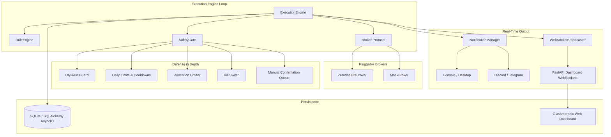

# Portfolio Automation Engine

> **Status: development scaffold — not for real-money trading or production deployment.**

This repository contains experimental components for configuration, rules,
broker adapters, safety checks, persistence, notifications, and a dashboard.
The current `portfolio-automation` CLI loads configuration, initializes
logging, and waits between polling intervals. It does not construct or run
`ExecutionEngine`, load strategy rules, start the dashboard, authenticate a
broker, or submit and monitor orders. Docker Compose starts that same CLI and
the dashboard as separate processes.

Treat the code as a foundation for further integration and testing, not an
automated trading system. Do not use it with live brokerage credentials or
financial decisions.

---

## Component map

The following diagram shows the intended relationships among the implemented
components; it is not the current CLI runtime wiring.



---

## Included components

- **Declarative YAML Strategies**: Define buy queues with priority ranking and sell rules using human-readable conditions (e.g., RSI, Moving Average Crossovers, Allocation Limits, Price Targets).
- **Broker Interfaces**: Interfaces and implementations for a Mock broker and Zerodha Kite Connect are present, but the CLI does not instantiate either one.
- **Multi-Layered Safety Gates**:
  - **Dry-Run Guard**: Simulate all order executions safely without real financial exposure.
  - **Kill Switch**: Immediate emergency halt that blocks any further order placement.
  - **Risk Governors**: Configurable daily trade counts, maximum daily investment volume, per-stock allocation percentages, and post-trade cooldown timers.
  - **Manual Confirmation**: Flag sensitive or high-value orders for explicit manual review before placement.
- **Asynchronous Multi-Channel Notifications**: Decoupled, non-blocking alert dispatch across Console, Desktop system notifications, Discord Webhooks, and Telegram Bots with rate-limiting throttling.
- **Dashboard Components**: A FastAPI dashboard, templates, WebSocket support, and settings routes can run independently of the CLI.
- **Container Scaffolding**: Docker and Docker Compose files are included for local development experiments; they do not make the application production-ready.

---

## Inspect or develop locally

### Prerequisites
- **Python 3.13+**
- **[uv](https://docs.astral.sh/uv/)** package manager
- **Docker & Docker Compose** (optional, for the included local containers)

### 1. Installation
Clone the repository and install dependencies using `uv`:
```bash
git clone https://github.com/VariableThe/portfolio-automation-engine.git
cd portfolio-automation-engine

# Install project and dev dependencies
uv sync --extra dev
```

### 2. Configuration

The tracked [`.env.example`](.env.example) provides placeholder environment
values. Before using Docker Compose, create its required local `.env` file:

```bash
cp .env.example .env
```

Keep the Mock broker and `dry_run: true` defaults in
[`config/default.yaml`](config/default.yaml). Do not add real brokerage or
notification credentials while inspecting this scaffold, and never commit
`.env`. This project is not ready for live broker credentials.

### 3. Running Locally
The documented CLI currently performs initialization and sleeps; it does not
execute an automation cycle or place orders:

**Terminal 1 (current CLI scaffold):**
```bash
uv run portfolio-automation
```

**Terminal 2 (independent FastAPI dashboard):**
```bash
uv run uvicorn portfolio_automation.dashboard.app:app --host 127.0.0.1 --port 8000 --reload
```
Open your browser to [http://127.0.0.1:8000](http://127.0.0.1:8000).

### 4. Running with Docker Compose

Docker Compose starts the same CLI scaffold and independent dashboard and
requires the local `.env` file described above. It is not a production
deployment path. The checked-in port mapping publishes port `8000` on all
host interfaces, and not every dashboard route requires authentication.
Do not expose this scaffold to an untrusted network; prefer the loopback-only
direct command above for local inspection:
```bash
docker-compose up -d --build
```
Check container logs and health status:
```bash
docker-compose logs -f
docker-compose ps
```

---

## Configuration Guide

The files below define inputs for the component layer. The current CLI does
not wire them into an execution engine, so changing them does not cause the
documented strategy behavior to run.

### System Configuration (`config/default.yaml`)
```yaml
broker:
  type: mock                   # 'mock' or 'zerodha'

execution:
  poll_interval_seconds: 60    # Loop execution interval
  market_open: "09:15"         # IST trading start time
  market_close: "15:30"        # IST trading close time
  buy_queue_on_failure: skip   # Action on order failure ('skip' or 'retry')

safety:
  dry_run: true                # Enable paper simulation mode
  max_daily_trades: 10         # Maximum executed trades per day
  max_daily_investment: 100000.0 # Maximum total INR spent buying per day
  max_allocation_per_stock: 0.20 # Max 20% total portfolio allocation per stock
  cooldown_minutes: 30         # Cooldown timer after a symbol trade
  manual_confirmation: false   # Require manual approval before executing
  kill_switch_enabled: true    # Enable emergency kill switch toggle

database:
  path: "data/portfolio.db"

notifications:
  enabled: true
  channels:
    console: { enabled: true, level: INFO }
    discord: { enabled: false, webhook_url: "${DISCORD_WEBHOOK_URL}" }
    telegram: { enabled: false, bot_token: "${TELEGRAM_BOT_TOKEN}", chat_id: "${TELEGRAM_CHAT_ID}" }
```

### Strategy Rules Syntax (`config/rules.yaml`)
Strategies are configured in structured YAML defining a prioritized `buy_queue` and parallel `sell_rules`.

#### Supported Rule Condition Types:
- `price_above` / `price_below`: Exact threshold price checks.
- `percent_profit` / `percent_loss`: Return-on-investment percentage triggers relative to average entry cost.
- `rsi`: Relative Strength Index momentum check (`period`, `lower` for oversold, `upper` for overbought).
- `ma_crossover`: Moving average comparison (`fast_period`, `slow_period`, `value: above/below`).
- `macd`: MACD trend direction (`fast_period`, `slow_period`, `signal_period`, `trend: bullish/bearish`).
- `allocation_percentage`: Enforces portfolio weighting bounds.
- `time_based`: Evaluates active trading hours (`start_time`, `end_time`).

---

## Usage Examples

### Example Strategy: RSI Dip Buy & Profit/Stop-Loss Exit
Save the following as `config/rules.yaml`:
```yaml
buy_queue:
  - symbol: RELIANCE
    priority: 1
    condition:
      type: rsi
      params:
        period: 14
        lower: 32
  - symbol: INFY
    priority: 2
    condition:
      type: price_below
      params:
        threshold: 1450.0

sell_rules:
  - symbol: RELIANCE
    condition:
      type: percent_profit
      params:
        percentage: 8.5
  - symbol: RELIANCE
    condition:
      type: percent_loss
      params:
        percentage: 3.0
```

### Dashboard routes

The dashboard exposes settings, safety, and rules routes for its own process.
Because the CLI does not construct an `ExecutionEngine` or share the dashboard
state, these routes do not control a running automation loop.

---

## Development Guide

### Adding a New Broker
1. Implement the `Broker` protocol defined in `src/portfolio_automation/broker/interface.py`.
2. Follow the complete [protocol](src/portfolio_automation/broker/interface.py), including `get_balance()`, `place_buy_order()`, and `place_sell_order()`; there is no `get_cash_balance()` or generic `place_order()` method.
3. Wire the implementation into an application entry point before relying on it; the repository does not currently include a broker factory or CLI integration.

### Adding a New Rule Condition
1. Create a custom evaluator function taking `(params: dict[str, Any], context: RuleContext) -> DecisionResult`.
2. Decorate the function with `@register_condition("your_condition_name")` inside `src/portfolio_automation/rules/conditions/`.
3. Import your condition file inside `src/portfolio_automation/rules/conditions/__init__.py` to register it on startup.

### Running Tests and Linting

The repository includes unit and integration-named test modules for its
components. No coverage result is asserted here.

```bash
# Run the complete test suite with coverage report
uv run pytest --cov=portfolio_automation --cov-report=term-missing

# Run only end-to-end integration tests (trading day simulation, failure scenarios, safety gates)
uv run pytest tests/integration/ -v

# Run formatting and linting checks
uv run ruff check src/ tests/
```

---

## Deployment considerations

This is not a production deployment checklist: the runtime integration
described above is still absent. The notes below are design considerations for
a future deployment, not evidence that the current project is ready for one.

If a future integrated version is deployed to a VPS or cloud server, use the
following as an initial review list rather than a deployment runbook:

### 1. Security & Access Control
- [ ] **Non-Root Execution**: Verify the Docker container is running under the secure non-root user (`appuser`, UID 1000).
- [ ] **API Authentication**: Add and verify authentication for all sensitive routes. The current `DASHBOARD_API_KEY` check covers the kill-switch and manual-confirmation routes, not every mutation or settings route.
- [ ] **Reverse Proxy & SSL**: Terminate SSL/TLS using Nginx, Caddy, or Traefik before routing traffic to port `8000`.
- [ ] **Firewall**: Restrict public access to port `8000`; only expose ports `80`/`443` via your reverse proxy.

### 2. Configuration & Safety Governors
- [ ] **Dry-Run Validation**: Start new deployments with `dry_run: true` in `config/default.yaml` for at least one trading day to verify strategy behavior without financial risk.
- [ ] **Daily Loss & Trade Limits**: Set strict boundaries for `max_daily_trades` and `max_daily_investment` tailored to your account size.
- [ ] **Kill Switch & Manual Review**: Keep `kill_switch_enabled: true`. For experimental strategies, enable `manual_confirmation: true`.

### 3. Storage & Observability
- [ ] **Persistent Volumes**: Ensure `/app/data` and `/app/config` are mounted as persistent Docker volumes to preserve SQLite database history (`portfolio.db`) across container restarts.
- [ ] **Notification Channels**: Enable at least one external alerting channel (Telegram or Discord) in `.env` to receive real-time fill alerts and error notifications on your mobile device.
- [ ] **Log Rotation**: Configure Docker log rotation or structured file logging to prevent unbounded disk growth.

---

## Troubleshooting

| Problem | Cause | Solution |
| :--- | :--- | :--- |
| `401 Unauthorized` on API mutations | Missing or incorrect API header | Ensure `X-API-Key` header matches `DASHBOARD_API_KEY` in `.env`. |
| `sqlite3.OperationalError: no such table` | Database uninitialized | Ensure app lifespan has run or volume mount permissions allow file creation in `/app/data`. |
| WebSocket disconnect immediately | CORS or proxy timeout | Verify proxy settings allow WebSocket upgrade connections on `/ws`. |
| Discord/Telegram alerts missing | Rate limit triggered or invalid tokens | Check logs for throttling warnings (`Throttled notification...`). Verify webhook URL / Bot token in `.env`. |

---

## Roadmap

- [x] Component implementations for rules, broker adapters, persistence,
  safety, notifications, and a dashboard.
- [ ] Integrate the CLI with the execution engine, broker construction, rules,
  persistence, and dashboard state.
- [ ] Establish a reviewed test, security, and operational baseline before any
  production or live-trading use.
